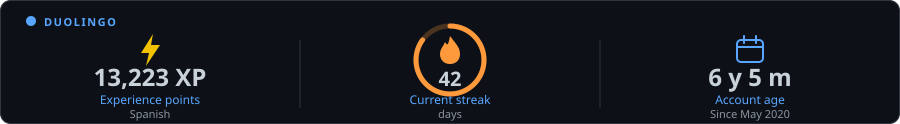
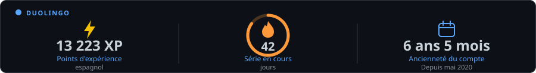
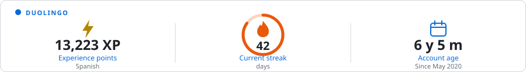
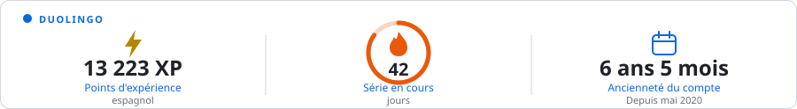
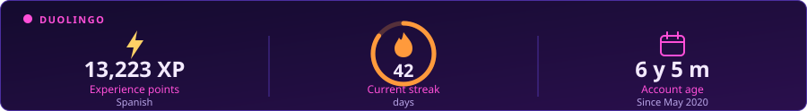
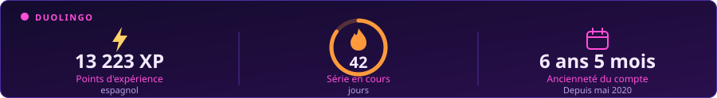
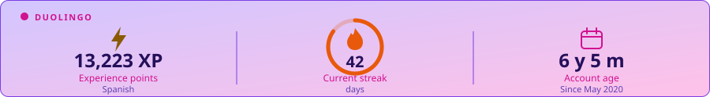
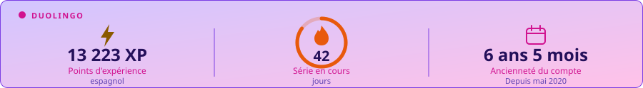
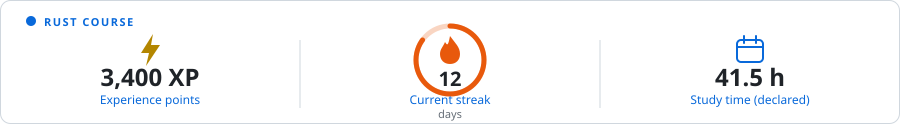

# learning-streak-card

One SVG card for your learning: experience points, current streak and the age of your account, from **Duolingo**, **Chess.com** or numbers you type yourself. It is built by a GitHub Action in your own repository: no server, no account, no token, no dependency.

<p align="center">
  
</p>

> The cards in this README are real output of the renderer, drawn from **sample data** (`npm run examples`), not from a real account.

> **Status: v0.1, pre-release.** The `@v0.1` tag used below exists once the first release is cut.

## ⚡ Quick setup

You need a GitHub repository where the card will live (for your profile, that is the repository named like your username). Everything below happens in that repository.

### Option 2: GitHub Actions (the way that works today)

> Option 1, a hosted URL with parameters, does **not** exist: it was studied and left out of v0.1 ([why](docs/cloudflare-study.md)).

**1. Create the workflow.** Add the file `.github/workflows/learning-streak-card.yml` with this content, and replace the username:

```yaml
name: Update learning streak card

on:
  schedule:
    - cron: "17 4 * * *"   # every day at 04:17 UTC; pick any minute you like
  workflow_dispatch:        # lets you start it by hand from the Actions tab

permissions:
  contents: write           # only to commit the SVG; no other permission, no token to create

concurrency:
  group: learning-streak-card
  cancel-in-progress: false

jobs:
  update:
    runs-on: ubuntu-latest
    timeout-minutes: 5
    steps:
      - uses: actions/checkout@v4

      - uses: Florian-85/learning-streak-card@v0.1
        with:
          provider: duolingo            # duolingo | chesscom | manual
          username: YOUR_DUOLINGO_USERNAME
          language: es                  # Duolingo course; remove the line for all courses
          theme: dark                   # dark | light | funky-dark | funky-light
          lang: en                      # en | fr
```

(The same file is in [`examples/workflow.yml`](examples/workflow.yml).)

**2. Run it once.** Open the **Actions** tab, choose *Update learning streak card*, click **Run workflow**. Wait for the green check. This step is required: **the SVG does not exist until the workflow has run once.**

If your repository forbids workflows from pushing, enable *Settings → Actions → General → Workflow permissions → Read and write permissions*.

**3. Paste the image** in your README (only after step 2 succeeded):

```html

```

That is all. The workflow refreshes the card every day and commits **only when something changed**.

### Examples for each provider

<details open>
<summary><b>Duolingo</b> (public profile, unofficial endpoint)</summary>

```yaml
with:
  provider: duolingo
  username: your-duolingo-username
  language: es          # optional: one course. Without it, the XP of all courses
```
</details>

<details>
<summary><b>Chess.com</b> (official public API)</summary>

```yaml
with:
  provider: chesscom
  username: your-chess-com-username
  mode: rapid           # rapid (default) | blitz | bullet | daily
```
</details>

<details>
<summary><b>Manual</b> (any service, no API)</summary>

Create `learning-streak.json` in your repository and edit it whenever you like:

```json
{
  "title": "Rust course",
  "xp": 3400,
  "streakDays": 12,
  "studyHours": 41.5
}
```

```yaml
with:
  provider: manual
  file: learning-streak.json
```

Every number on the card is exactly what the file says; a field you leave out is shown as "—". Allowed fields: `xp`, `streakDays`, `studyHours`, `startedOn` (`"2025-01"`), `title`. Default columns: `xp`, `streakDays`, then `studyHours`. Pick others with `"columns": ["studyHours", "streakDays", "startedOn"]`.
</details>

## Options

| Option | Values | Default | Used by |
|---|---|---|---|
| `provider` | `duolingo`, `chesscom`, `manual` | required | all |
| `username` | public account name | required | duolingo, chesscom |
| `language` | course code, e.g. `es`, `fr`, `de` | all courses | duolingo |
| `mode` | `rapid`, `blitz`, `bullet`, `daily` | `rapid` | chesscom |
| `file` | path of your JSON file | required | manual |
| `theme` | `dark`, `light`, `funky-dark`, `funky-light` | `dark` | all |
| `lang` | `en`, `fr` | `en` | all |
| `title` | text in the card header | provider name | all |
| `output` | `.svg` path inside the repository | `assets/learning-streak.svg` | all |
| `commit` | `"true"` / `"false"` | `"true"` | Action |
| `strict` | `"true"` fails the run when the source is down instead of keeping old values | `"false"` | all |

The same options exist as CLI flags (`--theme funky-dark`, `--no-animation` to get a static card).

### Themes and languages

| | `en` | `fr` |
|---|---|---|
| `dark` |  |  |
| `light` |  |  |
| `funky-dark` |  |  |
| `funky-light` |  |  |

Chess.com (no streak exists there, so the middle column shows the best rating) and manual:




## What the card shows, and what it never pretends

| Column | Duolingo | Chess.com | Manual |
|---|---|---|---|
| Left | XP of the course (or all courses) | current rating of the mode | `xp` |
| Middle | current streak, in days | best rating of the mode | `streakDays` |
| Right | **account age** and creation month | games played in the mode | `studyHours` (declared) |

- A number the source does not give is shown as **"—"** with "not provided". It is never replaced by 0 or by an estimate.
- **Account age is not study time.** Duolingo gives the creation date of the account, nothing about the time actually spent learning, so the card says "Account age".
- Hours and start dates from the manual provider are labelled "declared": they are yours, not measured.

## When the source is down

A temporary outage must not destroy your card.

- The last valid values are stored **inside the SVG file** (a `<metadata>` element), so there is nothing else to host.
- If the source fails (network, timeout, rate limit, profile now private, changed API), the card is redrawn with the previous values and a visible notice, *"Source unreachable · values as of <date>"*. The run stays green but shows a **warning** in the Actions log and summary. Set `strict: "true"` if you prefer a red run.
- Old values are only reused for the **same** account and settings.
- On the very first run there is nothing to keep: the run fails with the reason and writes no file.
- A wrong configuration (unknown theme, missing username) always fails, it is never hidden by old data.

## Known limitations per provider

| Provider | Access | Limitations |
|---|---|---|
| **Duolingo** | **Unofficial** public profile endpoint (`/2017-06-30/users`), no login. | Can change or disappear without notice. The profile must be public. Gives XP, streak and creation date only: **no level, no study time**. A streak is the one Duolingo reports at that moment. **Terms risk:** Duolingo's Terms and Conditions (revised 2025-09-08) forbid using "data mining, robots, scraping, or similar data gathering" to obtain Service Content. Whether a public profile counter is Service Content is not settled, so this provider is used at your own risk and may be blocked; Chess.com and manual have no such issue. |
| **Chess.com** | Official public API, no key. | No streak (shows best rating instead). Data refreshes about every 12 to 24 hours on their side. A mode never played gives an error. Chess.com asks to respect its branding: the card uses none of its logos. |
| **Manual** | Local file. | You keep the numbers up to date. |

More details on data use: [docs/privacy-and-api-use.md](docs/privacy-and-api-use.md).

## Troubleshooting

| Symptom | Cause and fix |
|---|---|
| The image is broken in my README | The workflow has not run yet: **Actions → Run workflow**, then check the file exists at the `output` path (default `assets/learning-streak.svg`). The `src` must match that path. |
| `Permission denied` / `403` when pushing | *Settings → Actions → General → Workflow permissions*: **Read and write**. Keep `permissions: contents: write` in the workflow. |
| `no Duolingo profile named …` | Wrong username, or the profile is private. Open `https://www.duolingo.com/profile/<name>` while logged out. |
| `no "xx" course on this profile` | `language` must be a course you study (`es`, `fr`…). Remove it for all courses. |
| `this player has no rapid rating yet` | Choose another `mode`. |
| Warning *Kept the last valid values* | The source was unreachable. The card is the last good one. If it repeats for days, the provider may have changed: open an issue. |
| The card does not update | GitHub caches images for a few minutes; hard-refresh. Then check the **Actions** tab. See the next question for a disabled schedule. |
| `Configuration problem: …` | Exit code 2: the message tells which option is wrong. |

Run it on your machine to debug (Node 18+):

```bash
git clone https://github.com/Florian-85/learning-streak-card
cd your-repo && node ../learning-streak-card/bin/cli.js --provider duolingo --username NAME --language es
```

## FAQ

**Do I need a token or an account on your service?** No. The workflow uses the `GITHUB_TOKEN` GitHub gives every run, and the providers read public data.

**Why not a URL like other README cards?** An `` can only show a file or answer a request. A hosted service would need servers that call the providers on behalf of everyone. That was studied ([docs/cloudflare-study.md](docs/cloudflare-study.md)) and is not part of v0.1; the Action works without any third party.

**My schedule stopped.** GitHub disables scheduled workflows of a **public** repository after 60 days without repository activity, and in forks they are off by default. Re-enable it in the Actions tab, or run it by hand. Whether the card's own commits count as activity is not guaranteed: if it happens to you, make any commit or run the workflow manually.

**Does it show my study time?** Only if you declare it with the manual provider. No API gives this reliably.

**Can I use several cards?** Yes: use two steps with different `output` files (and different `title`).

**Can I add my service?** Yes, a provider is one file: [docs/adding-a-provider.md](docs/adding-a-provider.md).

## Development

```bash
node --test          # 50+ offline tests, no network, no dependency
npm run examples     # regenerates examples/*.svg
```

Layout: `src/render.js` (pure SVG renderer), `src/contract.js` (data contract), `src/providers/*` (one file per service), `src/generate.js` (collect, validate, fall back), `bin/cli.js`, `action.yml`.

## License, credits and API use

- Copyright (C) 2026 Florian BERTHET. Code under the [GNU AGPL-3.0](LICENSE), the same licence as Daily Banner: you may use, modify and share it, and a modified version offered as an online service must publish its source. The cards you generate are yours.
- The layout (a number on each side, a ring in the middle) is inspired by [GitHub Readme Streak Stats](https://github.com/DenverCoder1/github-readme-streak-stats) (MIT). No code or asset of that project is used.
- **Duolingo** and **Chess.com** are trademarks of their owners. This project is not affiliated with or endorsed by them, and uses none of their logos or characters. Data belongs to the respective services and users; the card only displays public profile numbers of the account you name.
- Please keep the schedule low (daily is plenty) to be kind to the services.
